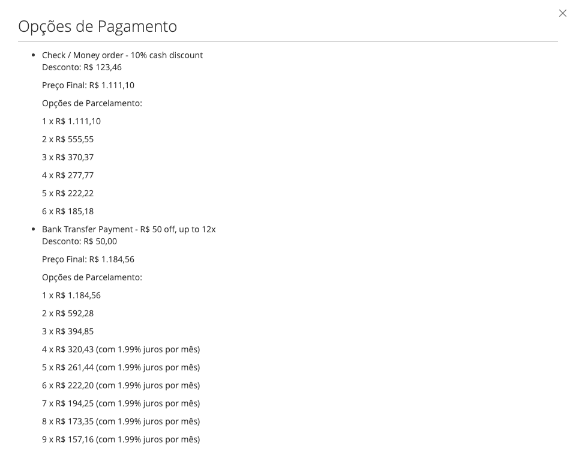
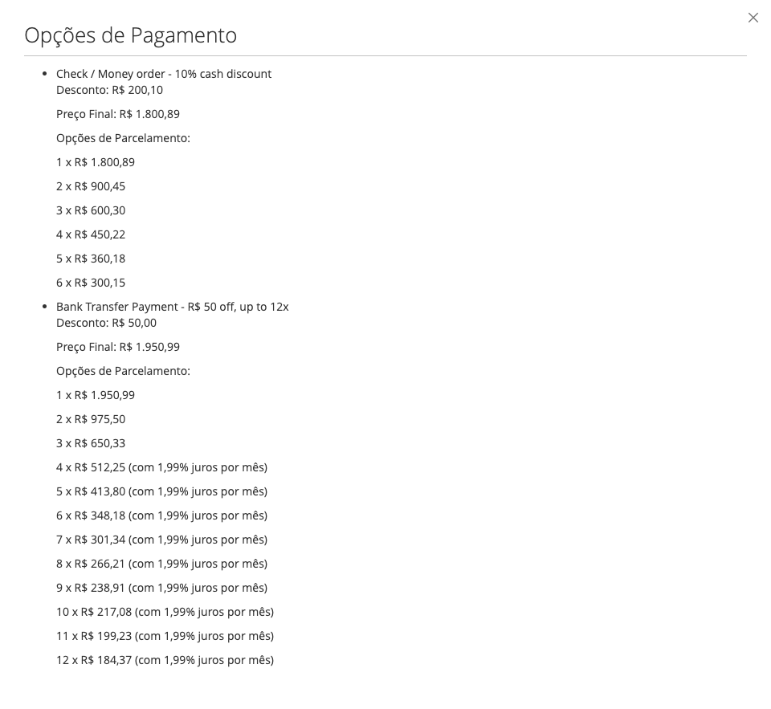
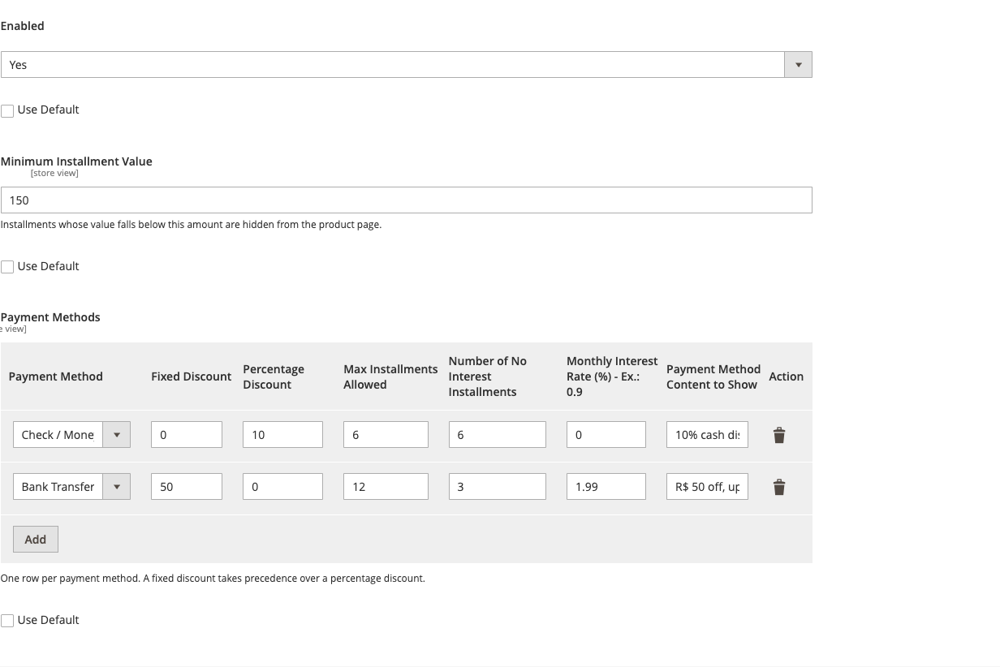

# Product Payment Options for Magento 2

[](https://github.com/roni-clei-santos/ProductPaymentOptions/actions/workflows/ci.yml)

Shows, on the product page, what the product costs **per payment method**: the discount for paying with a given
method, the final price and the installment plan, with interest-free and interest-bearing installments.

## The problem it solves

In Brazilian e-commerce the price is rarely one number. "R$ 1.234,56" can also be "R$ 1.111,10 in cash with 10 % off" or
"6 × R$ 185,18 interest-free", and the shopper wants to know that on the product page, not at the last step of the
checkout. Magento core has no notion of a price per payment method, so nothing on the product page can say it.

This module lets the merchant describe, per payment method, a discount (fixed or percentage), how many installments are
offered, how many of them are interest-free and the monthly interest of the rest. The product page then answers the
question before it is asked, and recalculates it when a configurable or bundle option changes the price.

## Features

- A **View Payment Options** button on the product page opens a modal with one block per configured payment method.
- Fixed or percentage discount per payment method (a fixed discount takes precedence).
- Installments: interest-free up to N, then the fixed-installment table (**Tabela Price**) at a monthly rate, with a
  **minimum installment value** below which an installment is hidden.
- Works with simple, configurable and bundle products; the amounts follow the selected options.
- Prices are formatted with the store's price format and rounded to cents.
- Configurable **per website and store view**; only the payment methods active in the store are shown.
- Translated to English and Brazilian Portuguese.

Grouped products are not supported (the block is removed from their page).

## Compatibility

| | |
|---|---|
| Declared | Magento Open Source / Adobe Commerce **2.4.7+** (`magento/framework` `^103.0.7`), PHP **8.2 – 8.3** |
| Tested end-to-end | Magento Open Source **2.4.8-p4**, PHP 8.3, MariaDB 10.6, OpenSearch 2.12, Luma theme with the sample data, `pt_BR` / BRL |
| CI | phpcs (Magento2 standard), phpstan level 9 and PHPUnit on PHP 8.2 and 8.3 |

The end-to-end tests (Playwright, in `e2e/`) were run against the Magento 2.4.8-p4 store above. Other themes may need
CSS adjustments for the modal.

## Installation

The module is installed straight from this repository with Composer:

```bash
composer config repositories.fineweb-product-payment-options vcs https://github.com/roni-clei-santos/ProductPaymentOptions
composer require fineweb/product-payment-options-extension:^1.0

bin/magento module:enable Fineweb_ProductPaymentOptions
bin/magento setup:upgrade
bin/magento setup:di:compile                  # production mode only
bin/magento setup:static-content:deploy -f    # production mode only
bin/magento cache:flush
```

## Configuration

`Stores > Configuration > Fineweb > Product Payment Options > Payment Options Configuration`. Choose the scope
(default, website or store view) in the scope switcher first: the payment methods offered in the table are the ones
active in that scope.

| Field | Meaning |
|---|---|
| Enabled | Shows the button and the modal on the product page. |
| Minimum Installment Value | Installments below this amount are hidden. |
| Payment Method | One of the active payment methods. |
| Fixed Discount | Amount subtracted from the price. Takes precedence over the percentage. |
| Percentage Discount | Percentage subtracted from the price. |
| Max Installments Allowed | Highest installment count offered (1 shows only the final price). |
| Number of No Interest Installments | Installments up to this number carry no interest. |
| Monthly Interest Rate (%) | Monthly interest of the installments after the interest-free ones, e.g. `1.99`. |
| Payment Method Content to Show | Free text shown next to the payment method. |

### How the amounts are calculated

```
final price    = price - fixed discount             (or price - price × percentage / 100)
installment n  = final price / n                    for n ≤ interest-free installments
installment n  = final price × i / (1 - (1 + i)^-n) for the following ones (Tabela Price), i = monthly rate / 100
```

The interest applies to the whole discounted price. Amounts are rounded to cents only when they are displayed, and an
installment below the minimum installment value is not shown. With a price of R$ 1.234,56, a fixed R$ 50 discount
(R$ 1.184,56 to pay), 3 interest-free installments and 1,99 % per month, the 4th installment is R$ 311,02 and the 9th
(R$ 145,06) is hidden by a R$ 150 minimum. The rate is written with the store's decimal separator (`1,99%` in `pt_BR`).

## Screenshots

| | |
|---|---|
|  |  |
| The button on the product page (price R$ 1.234,56). | The modal: discounts, final prices and installments. |
|  |  |
| A configurable product: the plan follows the chosen size (R$ 2.000,99). | The configuration table at website scope. |

They were captured by the end-to-end tests, so they show what the module renders.

## Development

```bash
./setup-dev.sh        # composer install, npm install and the git hooks (core.hooksPath = .githooks)
composer check        # blacklist, phpcs (warnings block), phpmd, phpstan level 9, tests-exist, multi-store, coverage
npm run lint          # ESLint 10 on the module JavaScript
```

The dependencies come from a public mirror of the original Magento packages, no `repo.magento.com` keys needed
(`composer config -g repositories.magento-mirror composer https://mirror.mage-os.org/`). The same checks run in CI on PHP 8.2
and 8.3; PHPUnit must keep every file at 70% line coverage or more. `CLAUDE.md` describes the structure and the rules.

The `e2e/` folder has the Playwright tests that run against a store with the module installed; see `e2e/README.md`.

## License

[MIT](LICENSE) © Roni Clei Santos
